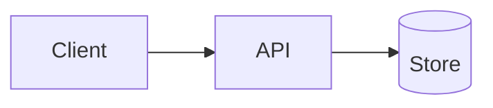

# 02 · System map — {{TITLE}}

## Where it fits
Which components, services and data stores this feature touches, and why each one.

| Component | Role in this feature | Owner | Change needed |
|---|---|---|---|
| | | | yes / no |

## Data flow

Describe each hop: protocol, payload, auth, owner.

## Requirement coverage
Every `REQ-` and `NFR-` from 01 lands somewhere.

| ID | Handled by |
|---|---|
| REQ-1 | |

## Dependencies
Internal services, external APIs, libraries, schemas, queues, secrets.

| Dependency | Type | Known / Unknown | Owner |
|---|---|---|---|

## Domain boundaries
Does this cross a domain? Is an architecture exception needed? If yes, name it here and stop.

## Open questions
- (none)
