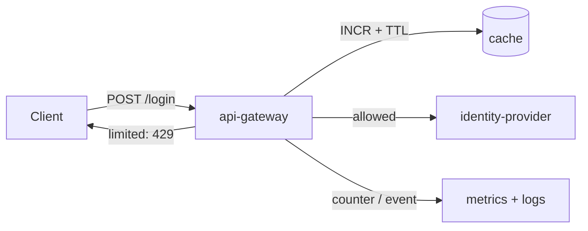

# 02 · System map — Rate-limit login attempts

## Where it fits

| Component | Role in this feature | Owner | Change needed |
|---|---|---|---|
| `api-gateway` (login route) | Hosts the new rate-limit middleware; returns 429 | Platform | yes |
| `cache` (Redis, existing) | Stores sliding-window counters, TTL 10 min | Platform | no (new keys only) |
| `identity-provider` (external) | Receives only non-limited attempts | Vendor | no |
| `metrics` (Prometheus, existing) | New counter `login_rate_limited_total{kind}` | Observability | no |
| `logging` (existing pipeline) | New structured event `login.rate_limited` | Observability | no |

## Data flow

- Client → gateway: HTTPS, existing auth-less login route.
- Gateway → cache: existing client, two keys per attempt (account hash, IP).
- Gateway → identity provider: unchanged; simply skipped when limited.

## Requirement coverage

| ID | Handled by |
|---|---|
| REQ-1 | gateway middleware + cache key `rl:acct:<hash>` |
| REQ-2 | gateway middleware + cache key `rl:ip:<ip>` |
| REQ-3 | cache TTL = window |
| REQ-4 | gateway response builder |
| NFR-1 | single cache round-trip (pipelined INCR) |
| NFR-2 | metrics counter + structured log in gateway |

## Dependencies

| Dependency | Type | Known / Unknown | Owner |
|---|---|---|---|
| Redis cache client | library (existing) | Known | Platform |
| Prometheus client | library (existing) | Known | Observability |
| Login route handler | internal code | Known | Platform |
| Identity provider API | external | Known, unchanged | Vendor |

## Domain boundaries
Stays inside the Platform domain. No architecture exception needed.

## Open questions
- (none)
